# Foráneo en apuros 🛒

**Come rico toda la semana sin quebrarte.**

App web + API para universitarios foráneos y gente recién independizada: eliges qué quieres comer, anotas lo que ya tienes en la alacena y la app te dice qué comprar y en qué súper cerca de ti sale más barato. La app **no compra nada**: solo te arma el menú y la lista.

- **Backend:** Django + Django REST Framework + PostgreSQL (con Docker)
- **Web:** Next.js 16 + Tailwind + shadcn/ui (carpeta `frontend/`)
- **Login:** correo y contraseña, Google, o Supabase Auth

<p align="center">
  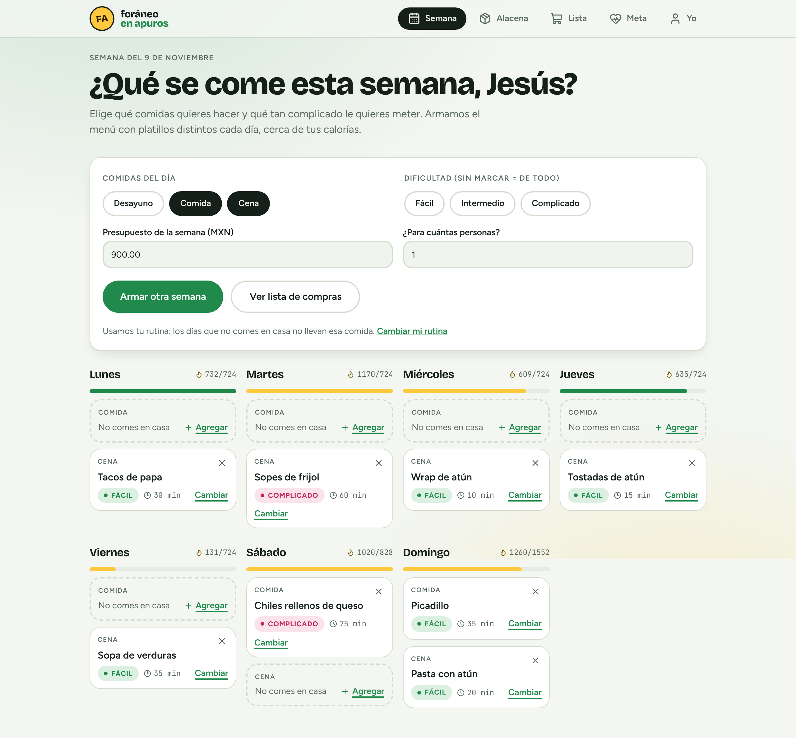
</p>

## Capturas

| Entrar | Lista de compras |
|---|---|
| 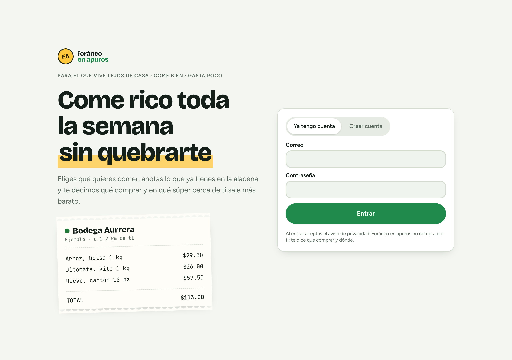 | 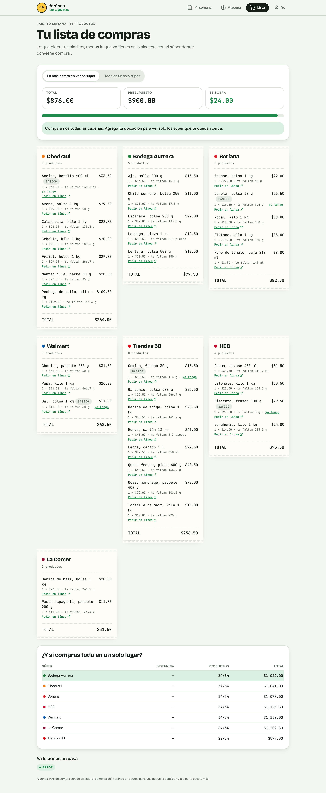 |
| **Alacena** | **Receta** |
| 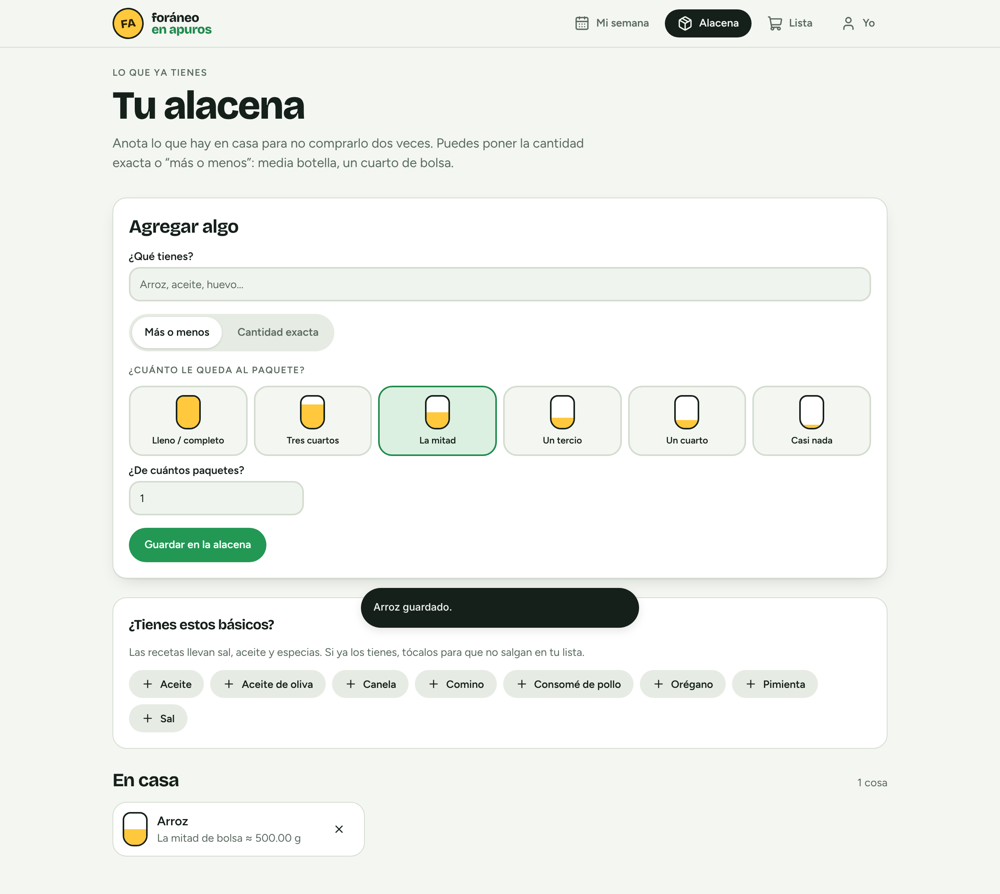 | 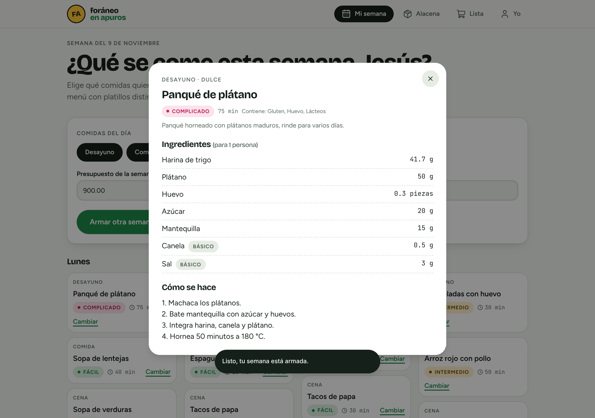 |
| **Meta de salud** | **Perfil** |
| 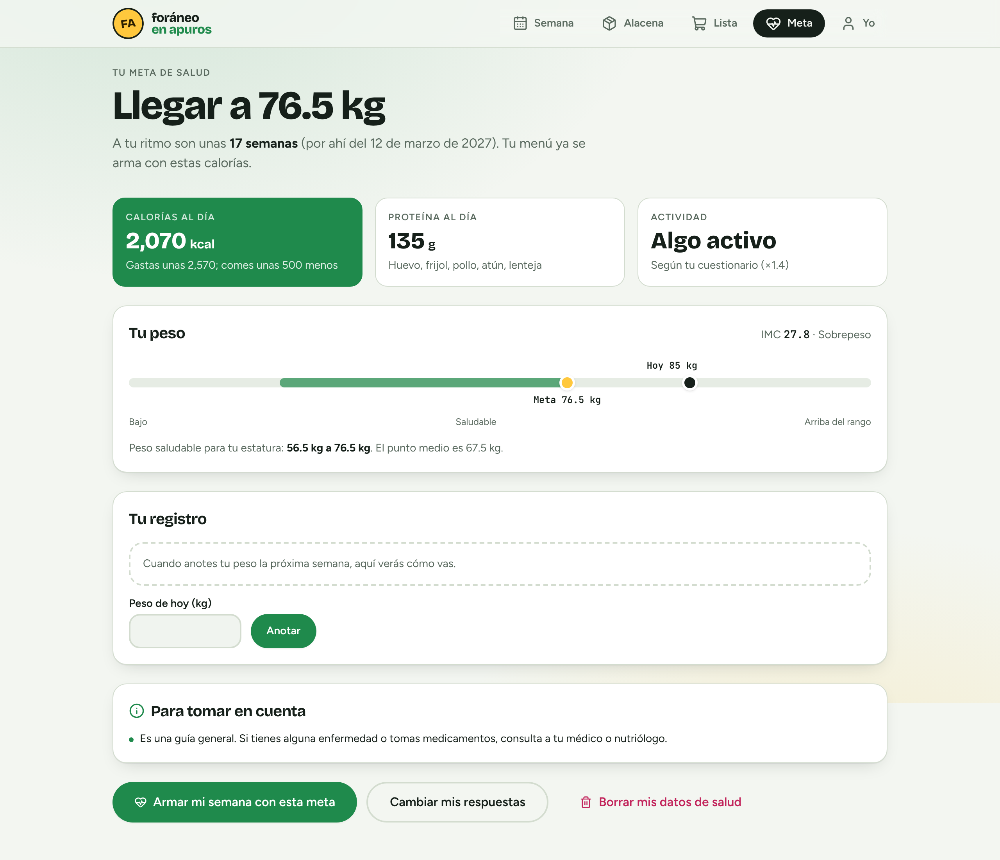 | 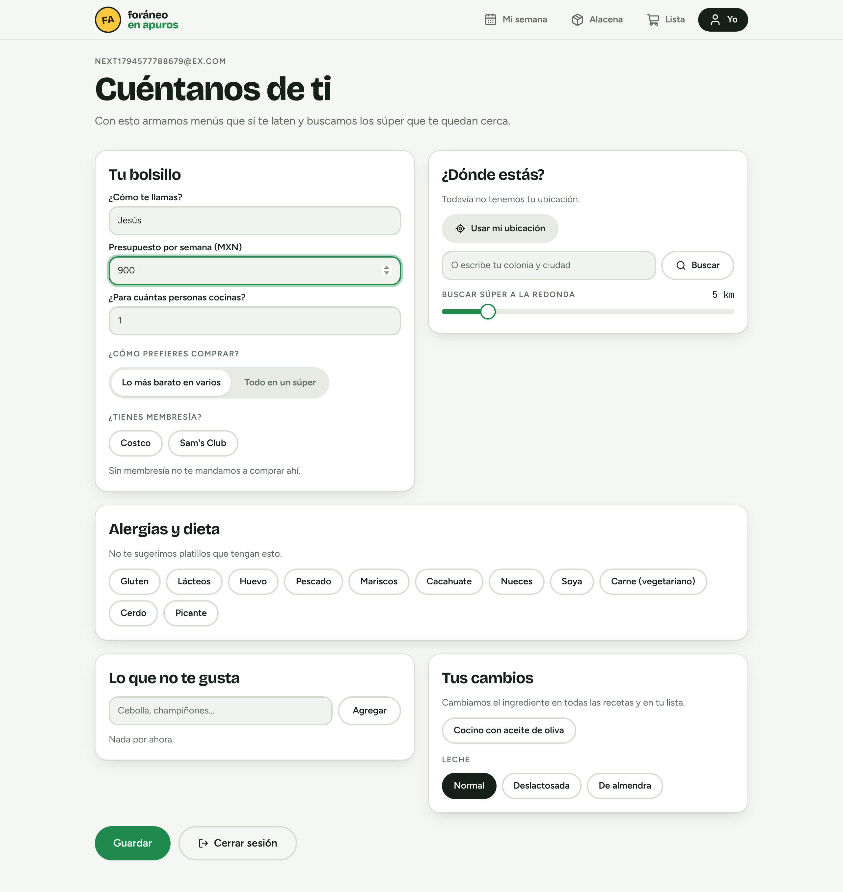 |

### En el celular

| Semana | Lista | Alacena | Rutina |
|---|---|---|---|
| 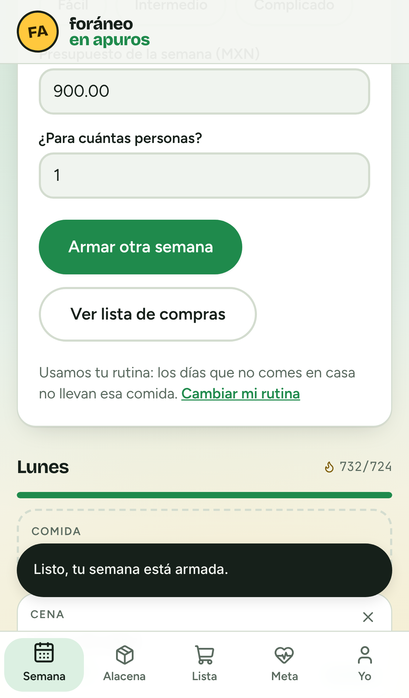 | 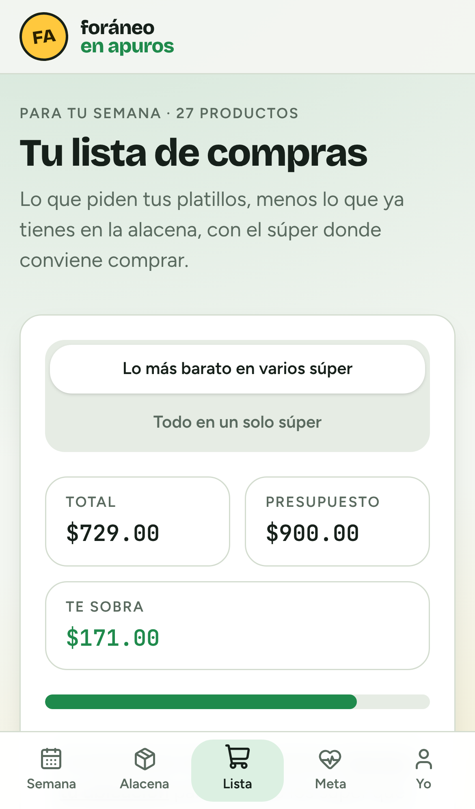 | 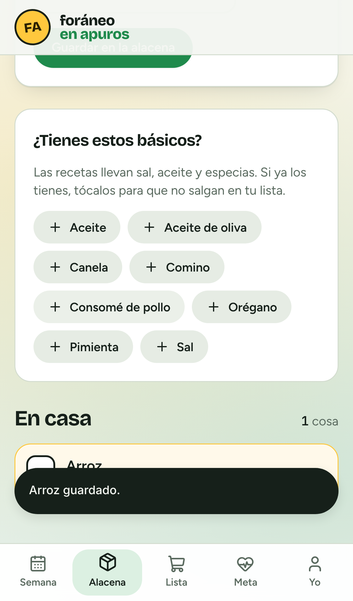 | 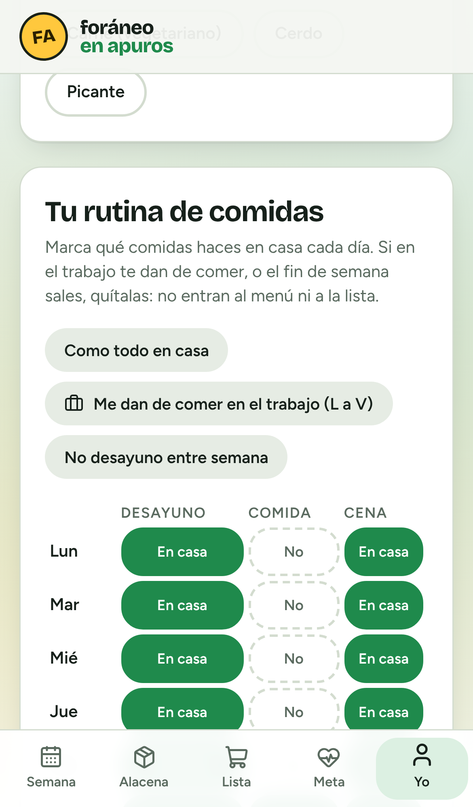 |
| **Meta: paso 1** | **Meta: resultado** | | |
| 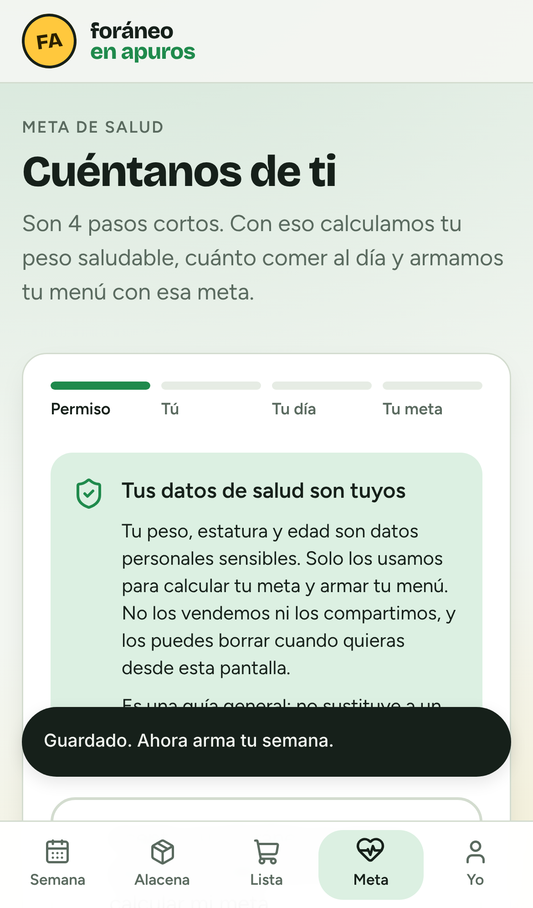 | 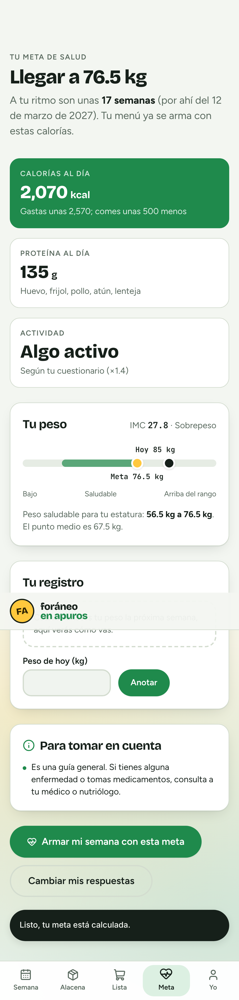 | | |

## ¿Qué hace?

1. Te registras con **correo y contraseña** o con **Google**.
2. Pones tu **presupuesto**, para cuántas personas cocinas y **dónde estás** (GPS o escribiendo tu colonia).
3. Eliges a **qué distancia** buscar súper (1 a 30 km) y si tienes **membresía** de Costco o Sam's.
4. Marcas **alergias y dieta** (lácteos, gluten, mariscos, vegetariano…), **lo que no te gusta** y tus **cambios** (cocinar con aceite de oliva, leche deslactosada o de almendra).
5. Eliges qué comidas quieres al día (**desayuno, comida, cena**), tu **rutina** (qué días comes fuera) y la **dificultad** (fácil, intermedio, complicado). La app arma un **menú variado** de lunes a domingo; puedes cambiar cualquier platillo y ver la receta.
6. Anotas lo que ya tienes en tu **alacena**, exacto (1 kg de arroz) o **más o menos** (media botella de aceite, un cuarto de bolsa de arroz).
7. Te da la **lista de compras** con lo que falta, en dos modos:
   - **Lo más barato en varios súper**: cada producto donde sale más barato.
   - **Todo en un solo súper**: eliges la tienda (o te recomendamos la más barata que tenga todo).
8. Opcional: una **meta de salud** (calorías y peso saludable) para que el menú se acerque a tus calorías.

## Cómo ejecutarlo

### Requisitos

- [Docker](https://docs.docker.com/get-docker/) con Docker Compose (la forma más fácil), **o**
- Python 3.12+ y, si quieres PostgreSQL, un servidor de Postgres 16
- Node.js 20+ para la web en `frontend/`

### 1. API con Docker (recomendado)

```bash
git clone https://github.com/SantVJes/foraneo-en-apuros.git
cd foraneo-en-apuros
cp .env.example .env          # opcional: cambia contraseñas, GOOGLE_CLIENT_ID, etc.
docker compose up --build
```

Esto levanta PostgreSQL y Django, aplica las migraciones y carga los datos de ejemplo. Luego abre:

- **App (web sencilla):** http://localhost:8000/
- **API:** http://localhost:8000/api/
- **Documentación de la API (Swagger):** http://localhost:8000/api/docs/
- **Admin:** http://localhost:8000/admin/

Para entrar al admin crea un usuario:

```bash
docker compose exec web python manage.py createsuperuser
```

Al arrancar se cargan:

- **54 recetas propias** (18 desayunos, 19 comidas, 17 cenas, de las tres dificultades), todas con sus básicos: sal, pimienta, aceite.
- **Recetas extra de TheMealDB** si hay internet (`IMPORTAR_RECETAS=0` para no traerlas).
- **9 supermercados** (Walmart, Bodega Aurrera, Soriana, Chedraui, La Comer, HEB, Costco, Sam's Club y Tiendas 3B) con **precios de ejemplo**.

> La ubicación del navegador (GPS) solo funciona en `localhost` o con HTTPS.

Para apagarlo: `docker compose down` (agrega `-v` si también quieres borrar la base de datos).

### 2. API sin Docker

```bash
python -m venv .venv
source .venv/bin/activate          # en Windows: .venv\Scripts\activate
pip install -r requirements.txt
export DJANGO_DEBUG=1              # modo desarrollo (sin esto pide DJANGO_SECRET_KEY)
export DB_ENGINE=sqlite            # o configura POSTGRES_* (o DATABASE_URL) para usar PostgreSQL
python manage.py migrate
python manage.py cargar_datos_demo
python manage.py createsuperuser   # opcional, para el admin
python manage.py runserver         # http://localhost:8000
```

En Windows (PowerShell) usa `$env:DJANGO_DEBUG="1"` y `$env:DB_ENGINE="sqlite"` en lugar de `export`.

### 3. Web (Next.js)

Con la API corriendo en el puerto 8000:

```bash
cd frontend
cp .env.example .env.local   # NEXT_PUBLIC_API_URL=http://localhost:8000
npm install
npm run dev                  # http://localhost:3000
```

Sin las variables de Supabase la web entra con el correo y contraseña de Django, así que puedes probar todo en tu compu sin cuentas externas. Pantallas: `/` entrar, `/semana/`, `/alacena/`, `/lista/`, `/meta/`, `/yo/`.

### Pruebas

```bash
docker compose exec web python manage.py test      # con Docker
DJANGO_DEBUG=1 DB_ENGINE=sqlite python manage.py test   # sin Docker (71 pruebas)
cd frontend && npm run lint                        # revisar la web
```

### Variables de entorno

Todas vienen explicadas en [`.env.example`](.env.example) (API), [`frontend/.env.example`](frontend/.env.example) (web) y [`.env.prod.example`](.env.prod.example) (servidor propio). Copia el ejemplo y llena tus valores; los archivos `.env` reales **no se suben** al repositorio (están en `.gitignore`).

## Publicarlo (deploy)

Hay dos caminos, los dos con planes gratis:

- **Nube gratis:** API en Render (`render.yaml`), base de datos y login en Supabase, web en Cloudflare Pages. Los pasos están abajo en [Stack y cómo lanzarlo gratis](#stack-y-cómo-lanzarlo-gratis).
- **Tu propio servidor:** una compu o VPS con Docker y Cloudflare Tunnel (sin abrir puertos), con respaldo diario de la base de datos:

  ```bash
  cp .env.prod.example .env.prod   # y llena los valores
  docker compose -f docker-compose.prod.yml --env-file .env.prod up -d --build
  ```

## Supermercados cercanos

Las sucursales se buscan en **OpenStreetMap** (API Overpass) alrededor de la ubicación del usuario y se guardan en la tabla `Sucursal`. Para cada cadena se toma la sucursal más cercana dentro del radio que eligió el usuario. Si el mapa no responde se usan las sucursales ya guardadas, y si no hay ninguna cerca se muestran todas las cadenas con un aviso. También puedes dar de alta sucursales a mano en el admin.

Para buscar por colonia se usa **Nominatim** (OpenStreetMap). Ambos servicios son gratuitos; para mucho tráfico conviene usar un servidor propio (`OVERPASS_URL`, `NOMINATIM_URL`).

## Recetas de TheMealDB

```bash
docker compose exec web python manage.py importar_recetas --area Mexican --categoria Breakfast --buscar taco --limite 60
```

TheMealDB está en inglés: los nombres de las recetas quedan en inglés, los ingredientes comunes se traducen y se ligan a los del catálogo para tener precio. Los que no se conocen se crean sin precio y salen en la lista como “sin precio”; se les puede poner precio en el admin.

## Precios

Los precios incluidos son **de ejemplo**. Se leen desde la tabla `Precio` y se pueden editar en el admin. Muchos supermercados no permiten leer sus páginas de forma automática, así que la fuente de precios es intercambiable: crea una clase que herede de `catalogo.fuentes_precios.FuentePrecios` (por ejemplo, para una API o un archivo de precios) y actívala con `FUENTE_PRECIOS`.

## Login con Google

1. En [Google Cloud Console](https://console.cloud.google.com/apis/credentials) crea un **ID de cliente de OAuth** (tipo aplicación web) y agrega `http://localhost:8000` como origen autorizado.
2. Pon el Client ID en `GOOGLE_CLIENT_ID` en tu `.env`.
3. Aparece el botón “Continuar con Google” en la app. Por API: manda el `id_token` a `POST /api/auth/google/`.

## Stack y cómo lanzarlo gratis

| Pieza | Tecnología | Dónde |
|---|---|---|
| Web | Next.js 16 + shadcn/ui + Tailwind (carpeta `frontend/`) | Cloudflare Pages |
| API | Django + DRF (este proyecto) | Render |
| Login | Supabase Auth (Google y correo) | Supabase |
| Base de datos | Postgres de Supabase, esquema privado `cartwise` | Supabase |

La web hace el login con Supabase y manda el token a Django; Django lo revisa con las llaves públicas
de tu proyecto (`cuentas/supabase.py`) y crea el usuario de la app la primera vez.

1. **Supabase** ([supabase.com](https://supabase.com), plan Free):
   - Crea el proyecto y corre `supabase/setup.sql` en *SQL Editor* (cambia la contraseña). Crea el esquema privado `cartwise` y el rol `cartwise_app`: así la API automática de Supabase no expone las tablas de la app.
   - *Authentication > Sign In / Providers*: activa **Google** con un Client ID de Google Cloud. En Google Cloud, en *URIs de redireccionamiento autorizados*, pon `https://<proyecto>.supabase.co/auth/v1/callback`.
   - *Authentication > URL Configuration*: Site URL = tu web (`https://cartwise.pages.dev`) y agrega `https://cartwise.pages.dev/**` a Redirect URLs.
   - Copia de *Project Settings*: la URL del proyecto, la *publishable key* y la cadena del **Session pooler** (Connect).
2. **API en [Render](https://render.com)**: sube el repositorio a GitHub, Nuevo > *Blueprint* (usa `render.yaml`). Variables:
   `DATABASE_URL` = la del Session pooler con usuario `cartwise_app.<ref>` y tu contraseña; `SUPABASE_URL`;
   `CORS_ALLOWED_ORIGINS` = la URL de tu web; `AMAZON_AFILIADOS_TAG` (opcional).
3. **Web en [Cloudflare Pages](https://pages.cloudflare.com)**: conecta el repositorio con raíz `frontend`, build `npm run build`, salida `out`, y las variables `NEXT_PUBLIC_API_URL` (la de Render), `NEXT_PUBLIC_SUPABASE_URL`, `NEXT_PUBLIC_SUPABASE_PUBLISHABLE_KEY`.

Notas: el plan gratis de Render duerme la API tras 15 minutos sin visitas (tarda como un minuto en despertar) y
Supabase pausa el proyecto tras 7 días sin uso. No uses Vercel Hobby: sus reglas no permiten sitios comerciales
(afiliados o pagos).

Seguridad en la nube: con `SUPABASE_URL` puesto, el registro y login propios de Django y la web vieja en `/`
se apagan solos (`LOGIN_LOCAL=0`), así que solo se entra por Supabase. La API limita los intentos de login
(10 por minuto) y las peticiones por usuario, exige https y no arranca sin `DJANGO_SECRET_KEY`. La web manda
cabeceras de seguridad desde `frontend/public/_headers`. Entra al admin (`/admin/`) solo con una contraseña larga.

`PRO_ACTIVO=0` (así viene en `render.yaml`) esconde el Plan Pro y quita el límite de 5 semanas.

Para probar todo en tu compu sin Supabase: corre Django (`python manage.py runserver`) y en `frontend/` `npm run dev`;
la web usa entonces el login con correo de Django.

## Meta de salud y rutina de comidas

- **Meta** (`/meta/` en la web, `/api/salud/` en la API): cuestionario de 4 pasos (permiso, datos, actividad, meta).
  Calcula IMC, rango de peso saludable (IMC 18.5 a 24.9), calorías con Mifflin-St Jeor por el factor de actividad,
  déficit de 250 o 500 kcal con mínimos de 1,200/1,500 kcal, proteína y semanas estimadas (`salud/calculos.py`).
  Sin déficit para menores de 18, embarazo o lactancia; sin meta para menores de 15. Registro de peso (`/api/salud/pesos/`)
  y botón para borrar todos los datos de salud (`DELETE /api/salud/`). La cuenta completa se borra con `DELETE /api/auth/yo/`.
  Es gratis; con meta, el menú elige platillos cerca de las calorías de cada comida y la semana muestra las calorías por día.
- **Rutina** (`rutina_comidas` en el perfil): qué comidas haces en casa cada día, por ejemplo sin "comida" de lunes a viernes
  si te dan de comer en el trabajo. El menú y la lista de compras solo llevan esas. En la semana, la X de cada platillo
  quita esa comida solo ese día (`cambiar-platillo` con `platillo_id: null`) y "Agregar" la vuelve a poner.

## Cómo gana dinero

La versión gratis arma el menú, la alacena, la lista y compara precios. Se monetiza de dos formas:

### 1. Plan Pro: $19 MXN al mes o $200 MXN al año

| | Gratis | Pro |
|---|---|---|
| Semanas guardadas | 5 | Sin límite |
| Ofertas en súper cerca (en la app y por correo) | | Sí |
| Plan de nutrición (calorías y macros por día contra tu meta) | | Sí |

El cobro es con Stripe. El mensual es suscripción con tarjeta; el anual es un pago único que acepta tarjeta **o efectivo en OXXO** (muchos estudiantes no tienen tarjeta).

Para activarlo:

1. Crea tu cuenta en [stripe.com/mx](https://stripe.com/mx) y completa los datos de tu negocio (RFC y CLABE para recibir los depósitos).
2. En **Configuración > Métodos de pago** activa **OXXO**.
3. En **Catálogo de productos** crea "Foráneo en apuros Pro" con dos precios: recurrente de **$19 MXN mensual** y único de **$200 MXN**. Copia los dos `price_...` a `STRIPE_PRECIO_MENSUAL` y `STRIPE_PRECIO_ANUAL`.
4. En **Desarrolladores > Webhooks** agrega `https://TU-DOMINIO/api/pro/webhook/` con los eventos `checkout.session.completed`, `checkout.session.async_payment_succeeded` e `invoice.paid`. Copia el secreto de firma a `STRIPE_WEBHOOK_SECRET`.
5. Pon `STRIPE_SECRET_KEY` y `APP_URL` y reinicia. Prueba primero con las claves de prueba (`sk_test_...`).
6. En **Configuración > Portal de clientes** actívalo para que la gente pueda cancelar sola.

Las alertas de ofertas se mandan con `python manage.py enviar_alertas_ofertas` (programa un cron semanal, por ejemplo los viernes). Configura `EMAIL_*` en el `.env`.

Endpoints: `GET /api/pro/`, `POST /api/pro/checkout/ {"plan": "mensual"|"anual"}`, `POST /api/pro/portal/`, `GET /api/ofertas/`, `GET /api/planes/{id}/nutricion/`. Si un usuario gratis intenta guardar la sexta semana, la API responde 403 con `"codigo": "limite_planes"`.

### 2. Links de afiliado en la lista de compras

Cada producto de la lista lleva "Pedir en línea" (a la tienda donde sale más barato) y "Amazon". Los links pasan por `/api/ir/<token>/`, que guarda el clic (admin > Clics de afiliado) y redirige con tu código. El token va firmado, así nadie puede usar tu dominio para redirigir a otras páginas.

- **Amazon Afiliados México** ([afiliados.amazon.com.mx](https://afiliados.amazon.com.mx)): regístrate con tu sitio, te dan un ID que termina en `-20`. Ponlo en `AMAZON_AFILIADOS_TAG`. Revisa sus condiciones: normalmente piden generar ventas en los primeros 180 días para aprobar la cuenta.
- **Redes de afiliados** (Awin, Admitad, etc.): pide entrar a los programas de los súper o tiendas que estén ahí. Te dan un link "deep link" con un lugar para la URL de destino. En el admin, en cada **Supermercado**, pega ese link en `plantilla_afiliado` poniendo `{url}` donde va la página, por ejemplo `https://www.awin1.com/cread.php?awinmid=123&awinaffid=456&ued={url}`.
- **Directo con la cadena**: si no tienen programa público, escríbeles con tus números de clics del admin. Mientras tanto el link igual funciona (sin comisión).
- `url_busqueda` de cada súper es su buscador con `{q}` (por ejemplo `https://super.walmart.com.mx/search?q={q}`). Si está vacío se busca en Google dentro de su sitio.

La app avisa en la lista que algunos links son de afiliado (lo piden Amazon y la Profeco).

## Endpoints principales

Todas las rutas (menos registro y login) llevan `Authorization: Bearer <access>`.

| Método | Ruta | Para qué |
|---|---|---|
| POST | `/api/auth/registro/`, `/api/auth/login/`, `/api/auth/google/` | Cuenta y sesión |
| GET/PATCH | `/api/auth/yo/` | Perfil: presupuesto, personas, `lat`, `lng`, `radio_km`, `modo_compra`, `membresias`, `restricciones`, `ingredientes_excluidos`, `cambios` |
| GET | `/api/opciones/` | Listas para formularios (alergias, unidades, fracciones…) |
| GET | `/api/ubicacion/buscar/?q=Roma Norte CDMX` | Buscar una dirección |
| GET | `/api/supermercados/cercanos/?lat=&lng=&radio_km=` | Súper cerca y a qué distancia |
| GET | `/api/platillos/?dificultad=facil,intermedio&tipo_comida=cena&para_mi=1` | Platillos (para_mi quita los que tienen tus alergias) |
| GET | `/api/ingredientes/{id}/precios/` | Comparar precios de un ingrediente |
| CRUD | `/api/alacena/` | Lo que tienes en casa |
| CRUD | `/api/planes/` | Plan de la semana |
| POST | `/api/planes/{id}/generar/`, `/api/planes/{id}/cambiar-platillo/` | Rehacer la semana o cambiar un platillo |
| GET | `/api/planes/{id}/lista-compras/?modo=varios` o `?modo=un_super&supermercado=3` | Lista de compras |

### Ejemplos

```json
PATCH /api/auth/yo/
{"lat": 19.418, "lng": -99.162, "radio_km": 5, "modo_compra": "un_super", "membresias": [7],
 "restricciones": ["mariscos"], "cambios": [{"original_id": 3, "reemplazo_id": 4}]}
```

```json
POST /api/alacena/
{"ingrediente_id": 3, "fraccion": "mitad"}            // media botella de aceite
{"ingrediente_id": 9, "cantidad": 1, "unidad": "kg"}   // 1 kg de arroz
```

Fracciones: `lleno`, `tres_cuartos`, `mitad`, `un_tercio`, `un_cuarto`, `casi_nada`. Unidades: `g`, `kg`, `ml`, `l`, `pieza`, `paquete`.

## Estructura

```
config/      configuración de Django
cuentas/     usuarios, login con correo y Google, preferencias
catalogo/    ingredientes, platillos, súper, sucursales (OpenStreetMap), precios, recetas de TheMealDB
pro/         Plan Pro (Stripe), links de afiliado, ofertas cerca, nutrición
despensa/    alacena, plan semanal y lista de compras (despensa/servicios.py)
frontend/    la web en Next.js
supabase/    SQL para preparar Supabase
docs/        capturas para este README
templates/ y static/app/   la web sencilla que sirve Django en /
```
